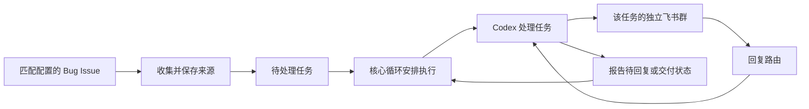

# Agent 自动化工程设计访谈

状态：以下保留首版限定 Bug 的历史设计，具体工程建议见 [架构草案](architecture.md)。当前所有任务共用[统一任务指导](prompts/task.md)，不按 Bug 或 Feature 选择 prompt。

已汇总为 [首版规格](../.scratch/agent-loop-v1/spec.md)，测试边界已确认。项目已配置本地 Markdown issue tracker，规格已发布并标记 `ready-for-agent`；无需创建远端 issue。

## 已表达的目标

- 独立的收集角色按配置条件收集 GitHub Issue，支持仓库、分配人、类型、标签等条件；首版仅收集符合条件的 Bug，不额外判断处理价值。
- 本地持久化这些记录；SQLite 是候选方案。
- 核心循环及时发现任务并调用 Codex；执行入口建议采用 App Server，Bug 启动提示词已按用户原文确定。
- 任务需要人工信息或确认时，通过飞书进行持续交流。
- 每个任务使用独立飞书群作为持续交流入口。
- 用户在飞书的回复进入之前对应的 Codex 会话，保持任务上下文。
- 架构保留按类型选择 prompt 的能力；首版只接入 Bug，Feature 暂不收集或执行。

## 当前工程与能力证据

核查日期：2026-11-04。

- 当前目录原为空目录，尚未初始化 Git，没有既有实现或项目契约需要兼容。
- 本机 `codex --version` 返回 `codex-cli 0.166.0`。`codex exec resume --help` 确认可以指定会话 ID 和后续提示词继续会话；这不等于已验证交互式审批链路。
- [Codex App Server 官方文档](https://learn.chatgpt.com/docs/app-server) 提供 `thread/resume`、`turn/start`、`turn/steer`，以及审批与用户输入请求。执行中追加内容与回答待决请求是不同的协议操作，需要分别处理。
- [飞书自定义机器人官方说明](https://open.feishu.cn/document/client-docs/bot-v3/add-custom-bot) 明确自定义机器人不能响应用户消息，交互场景应使用应用机器人。
- [飞书开放平台概述](https://open.feishu.cn/document/client-docs/intro?from=op_develop_app) 描述了机器人按告警或工单创建专属处理群的能力。具体租户权限和任务群交互尚未实测。

## 已确认的边界

| 编号 | 决策 | 用户确认的结论 |
| --- | --- | --- |
| Q1 | 第一版自动执行到哪一步 | 完成诊断、修改和验证，提交分支并创建草稿 PR；合并、部署和关闭 Issue 留给用户决定 |
| Q2 | 任务交流入口 | 只做每任务独立群；采用前轮建议的共享应用机器人提供交互，不要求每任务独立机器人身份 |
| Q3 | 收集与启动的职责 | 收集只负责收集，核心循环负责启动；目前不需要系统判断哪些 bug 值得处理 |
| Q4 | 使用人数 | 单人使用 |
| Q5 | 收集资格与启动 | 匹配配置条件后自动安排处理；首版限定 Bug、分配人默认用户，条件可配置，无需额外启动标签或人工启动；范围按 Q20 更新 |
| Q6 | 运行位置及离线预期 | 首版在用户本机运行，接受机器休眠或离线时暂停；恢复在线后检查状态再继续 |
| Q7 | 何时停下来 | 由任务 prompt 和后续对话控制；Bug 初始 prompt 已在 Q19 指定复现后等待，不在调度器中预设所有类型的统一审批阶段 |
| Q8 | 执行中主动发来的补充 | 立即追加到对应任务的 Codex 会话 |
| Q9 | 仓库范围与首次收集 | 显式配置仓库，首次纳入匹配条件的未关闭 Issue，包括历史积压；首版条件按 Q20 限定 Bug |
| Q10 | 多任务如何推进 | 允许多个任务并行，不设置全局任务并发上限；任务等待用户时不阻塞其他任务。每个任务使用独立工作目录和分支 |
| Q11 | 草稿 PR 后的持续交流 | 保留任务群和原会话；用户反馈继续修改原分支并更新同一 PR，交付待验收阶段不自行持续执行 |
| Q12 | 新分配 Issue 的发现延迟 | 本机在线且 API 正常时，以约一分钟内发现并入队为目标；入队与开始执行分开衡量 |
| Q13 | Issue 被关闭或取消分配 | 发现后暂停对应任务的自动执行并通知用户，保留群、会话、代码和 PR；重新满足收集条件时仍需明确恢复，避免旧任务自行重启 |
| Q14 | 程序重启后的恢复 | 自动核对并恢复原任务。原来执行中的任务在确认执行状态后继续；待回复和待验收任务保留等待状态；不重复创建群、分支或 PR |
| Q15 | Issue 标题或描述更新 | 保存最新来源及变更记录；未执行任务使用最新内容，执行中任务将变化作为来源更新追加到原会话。等待或待验收任务只记录并通知，不因来源更新擅自启动 |
| Q16 | Prompt 组织方式 | 按任务类型配置独立 prompt；首版 Bug 使用 Q19 原文，Feature 只预留扩展 |
| Q18 | 类型选择规则 | 优先原生 Type，未填写时按分类标签映射，冲突不擅自判定；未分类处理按 Q23 跳过 |
| Q19 | Bug 初始 prompt | 原文：“使用poteto-mode skill,先定位并在freedom上实机复现出来确实存在bug,然后等我确认后再给出修复方案进行修复” |
| Q20 | 首版类型及收集配置 | Feature 暂不接入，保留扩展；仅收集 Bug，收集条件做成配置，支持分配人、标签等 |
| Q17 | 飞书消息类型 | 第一版支持文字、截图和日志附件 |
| Q21 | 实机资源协调归属 | Freedom 的实例、设备及操作协调由执行任务依据 prompt、skill 和对话处理，不属于 agent loop 职责 |
| Q22 | 部署和重启决策归属 | 由任务 prompt、skill 和对话明确，agent loop 不设置 Freedom 专用部署、重启或审批策略 |
| Q23 | 非明确 Bug 来源 | 未分类、分类冲突或未映射类型先跳过，保留筛选原因；分类明确且匹配条件后再收集，不预先创建任务或群 |
| Q24 | 收集配置变更 | 新配置只影响后续收集；已有任务沿用创建时的筛选条件快照，不因配置调整自动取消 |
| Q25 | 来源类型或标签变更 | 变化导致不再满足创建时条件时，暂停并通知，保留原群、会话和代码；明确恢复后继续，不自动切换 prompt |

相关决策：[任务独立群](adr/0001-task-conversation-groups.md)、[收集与执行分离](adr/0002-separate-collection-from-execution.md)、[并行处理与任务隔离](adr/0003-parallel-isolated-tasks.md)、[编排与任务行为分离](adr/0004-orchestration-and-task-behavior.md)。

## 已确定的流程

收集与启动是职责分离，不要求增加一次人工确认。机器离线不改变任务归属；执行中补充发往已有会话。任务 prompt 决定业务上的提问或等待时机，调度器负责可靠保存和传递这些状态；具体状态协议待设计。

## 职责边界

Agent loop 负责来源收集、条件匹配、模板选择、执行启动、会话关联、状态保存、飞书消息和附件转发以及恢复。

执行任务依据 prompt、skill 和用户对话决定如何定位、复现、提出方案、修改、验证，以及如何使用 Freedom。核心循环消费通用的执行事件和等待请求，不实现 Freedom 状态机、实机资源锁或部署审批流程。

Bug prompt 中的复现后等待属于任务行为；agent loop 的责任是可靠保留待决请求并将用户回复送回原会话。重启恢复不得自行把通用待回复状态变成继续执行。

Q6 的能力依据：[飞书长连接接收事件](https://open.feishu.cn/document/ukTMukTMukTM/uYDNxYjL2QTM24iN0EjN/event-subscription-configure-) 支持企业自建应用通过出站连接接收事件，无需公网 IP 或域名。这只证明本地接收方案可行，不代表机器离线时消息一定无损，补偿方案需后续验证。

## 实施前的接入信息

后续接入需要 GitHub 账号、仓库及本地路径映射、基准分支，以及飞书应用和用户标识。Freedom 等任务专属环境信息由 prompt、skill 或任务上下文提供，不成为 agent loop 的专用配置结构。凭证通过配置引用或环境变量读取，不记录真实密钥。本轮仅设计未来任务，尚未访问或修改目标仓库、Freedom、GitHub 或飞书。

## 需求澄清结果与实施验证

本轮列出的产品行为和职责边界均已确认，包括配置变更与来源变更的区别。暂无待用户决定的首版产品问题；实现细节和真实集成仍待完成。

以下属于实施验证和接入配置，不需要用户设计技术细节：

- 通用待回复与轮次结束、原生请求及结构化回报的衔接；异常退出后能否准确恢复原会话。
- 飞书应用权限、建群、附件下载、图片投递及离线消息补偿的真实端到端验证。
- 确定具体账号、仓库、基准分支、飞书应用，以及模型、运行参数、存储目录等配置值。

已确认保留原群、会话和代码；首版沿用保留策略，不增加自动删除策略。配置格式、数据库结构、重试和消息去重等工程细节由实现方案负责。

to-spec 阶段已确认测试边界：整个任务编排服务作为主要入口，使用真实本地持久化和临时工作区，可控的 GitHub、飞书和 Codex 适配器验证外部行为；另做真实服务的端到端验证。该确认不表示任何测试已经执行或通过。
